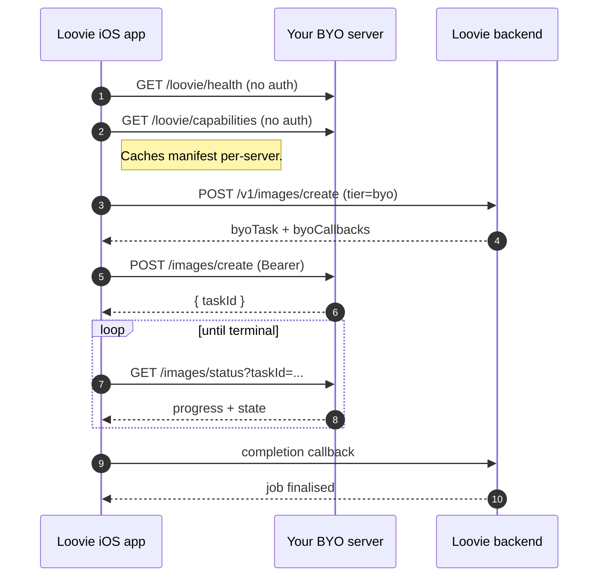

# The BYO contract in human-readable form

This page is a friendly companion to the normative OpenAPI 3.1 spec at [`openapi/loovie-server.openapi.yaml`](../openapi/loovie-server.openapi.yaml). The YAML is the source of truth; this page paraphrases the same shape so you can implement the contract without reading YAML.

> **Beta API stability.** While we are on the `0.x` line, this contract may introduce breaking changes between minor versions. We document every change in [`CHANGELOG.md`](../CHANGELOG.md) and reflect it in `info.version` (and `schemaVersion` on the capabilities manifest when the shape changes). Pin to a specific tag or commit SHA if you depend on it. Strict semver kicks in at `1.0.0`.

## The big picture



The Loovie backend **never** calls your server. The mobile app does. Direct device-to-server traffic is the only path. Your server URL and bearer token live in the app on the user's device only; they are not accessible to Loovie staff or sent to Loovie's backend.

## ANY server, ANY model, ANY backend

Three things are **not** part of the contract and you can swap them independently:

1. **The inference backend.** ComfyUI is the reference we publish (`comfyui-loovie/`), but anything serving HTTP works: Wan2GP, a hand-rolled FastAPI / Express / Go server, a different node-graph engine, a wrapper around `diffusers`, etc. A small FastAPI proof lives in `examples/minimal-server/`.
2. **The model.** FLUX.2 Klein and LTX-2.3 are what our reference workflows use, but the contract knows nothing about which model is running. Image: SDXL, SD3.5, Stable Cascade, Lumina, HiDream, your own fine-tune, whatever. Video: WAN 2.x, HunyuanVideo, CogVideoX, Mochi, AnimateDiff variants, whatever. You're responsible for the licence on whichever model you pick.
3. **The hardware.** NVIDIA, AMD (ROCm), Apple Silicon, multi-GPU, single-GPU: the contract has nothing to say. Your model and workflow set the VRAM floor, not us.

The contract is the line. If your server speaks the request and response shapes below, the Loovie app will drive it the same way it drives ours.

## Endpoints are conditional on capabilities

A server that omits `images` from `/loovie/capabilities` MAY omit `/images/create` and `/images/status` entirely. Same for `ss_videos` and `/videos/*`. The app only calls the endpoints your capabilities advertise.

`/loovie/health` and `/loovie/capabilities` are **always required** and **always unauthenticated**.

## The required endpoints

### `GET /loovie/health` (no auth)

Returns a small readiness signal.

```json
{
  "code": 200,
  "data": {
    "version": "0.1.0",
    "status": "ok",
    "phase": "ready",
    "detail": ""
  }
}
```

`phase` is one of `ready`, `booting_up`, `downloading_models`. `status` is `"ok"` once the real extension is loaded.

### `GET /loovie/capabilities` (no auth)

The single most important endpoint. Tells the app what your server can do.

```jsonc
{
  "schemaVersion": 3,        // int, REQUIRED. Currently 3.
  "version": "0.4.0",        // optional string, telemetry only.
  "hardware": {              // optional; lets the app show which models fit
    "gpuName": "RTX 5090",
    "vramGb": 32
  },
  "models": {                // v2 source of truth. Omit a group if empty.
    "images": [
      {
        "id": "qwen-image-2.1",
        "label": "Qwen-Image 2.1",
        "default": true,
        "recommended": true,
        "vramGb": 12,
        "recommendedVramGb": 24,
        "capabilities": ["t2i", "i2i"],
        "referenceCount": 10,
        "resolution": ["1K", "2K"],
        "aspectRatios": ["auto", "1:1", "4:3", "3:4", "16:9", "9:16"],
        "variants": [
          { "id": "turbo", "label": "Turbo", "default": true },
          { "id": "base", "label": "Base" }
        ],
        "promptCharLimit": 3000
      }
    ],
    "ss_videos": [
      {
        "id": "pika-flex",
        "label": "Pika H3 Flex",
        "default": true,
        "vramGb": 24,
        "recommendedVramGb": 32,
        "capabilities": ["t2v", "i2v", "fl2v", "ref2v"],
        "referenceCount": 1,          // frames for i2v
        "maxReferenceImages": 9,      // images for ref2v
        "referencesExcludeFrames": true,
        "resolution": ["480p", "768p"],
        "aspectRatios": ["auto", "16:9", "9:16", "1:1"],
        "durations": [5, 6, 7, 8, 9, 10, 11, 12, 13, 14, 15],
        "audio": "always",            // none | optional | always
        "variants": [
          { "id": "official", "label": "Official", "default": true },
          { "id": "turbo", "label": "Turbo", "draft": true },
          {
            "id": "hd",
            "label": "HD",
            "capabilities": ["t2v", "i2v", "fl2v"],
            "maxReferenceImages": 0
          }
        ],
        "promptCharLimit": 3000
      },
      {
        "id": "ltx-2.5",
        "label": "LTX 2.5",
        "capabilities": ["t2v", "i2v", "fl2v", "ref2v", "edit", "retake", "extend", "motion"],
        "referenceCount": 1,
        "maxReferenceImages": 4,
        "referencesExcludeFrames": true,
        "maxSourceVideoSeconds": 21,
        "minSourceVideoSeconds": 3,
        "retakeMaxDurationSeconds": 16,
        "extendMaxDurationSeconds": 20,
        "maxContextSeconds": 20,
        "cameraMotions": ["static", "dolly_in", "dolly_out", "dolly_left", "dolly_right", "jib_up", "jib_down", "focus_shift"],
        "supportsKeepOriginalAudio": true,
        "upscaleResolutions": ["1080p", "2K", "4K"],
        "maxUpscaleFactor": 2,
        "resolution": ["540p", "720p", "1080p", "2K"],
        "durations": [2, 3, 4, 5, 6, 7, 8, 9, 10],
        "audio": "optional",
        "variants": [{ "id": "fast", "default": true }]
      }
    ],
    "music": [
      {
        "id": "yue2",
        "label": "YuE2",
        "default": true,
        "capabilities": ["t2m"],
        "variants": [{ "id": "fast", "label": "Fast", "default": true }],
        "maxDurationSeconds": 240,
        "supportsVocals": true,
        "supportsInstrumental": true,
        "promptCharLimit": 2000
      }
    ],
    "sfx": [
      {
        "id": "stable-audio-3",
        "label": "Stable Audio 3",
        "default": true,
        "capabilities": ["t2s"],
        "variants": [{ "id": "small", "label": "Small", "default": true }],
        "maxDurationSeconds": 60,
        "supportsNegativePrompt": true,
        "promptCharLimit": 2000
      }
    ]
  },

  // OPTIONAL v1 compatibility view for released app builds. It describes the
  // DEFAULT model only, and MUST stay inside the v1 closed enums. Omit it when
  // the default model cannot be expressed that way (e.g. H3's 480p/768p).
  "images": {
    "capabilities": ["t2i", "i2i"],
    "referenceCount": 10,
    "resolution": ["1K", "2K"],
    "variants": ["fast", "pro"],
    "aspectRatios": ["auto", "1:1", "16:9", "9:16", "4:3"],
    "promptCharLimit": 3000
  },
  "ss_videos": {
    "capabilities": ["t2v", "i2v", "fl2v"],
    "referenceCount": 1,
    "resolution": ["720p", "1080p"],
    "variants": ["fast", "pro"],
    "aspectRatios": ["auto", "16:9", "9:16", "1:1"],
    "durations": [2, 3, 4, 5, 6, 7, 8, 9, 10],
    "supportsAudio": true,
    "promptCharLimit": 3000
  }
}
```

**Hard rules.**

- `models` is the v2 source of truth. The app reads it first.
- Clients send `x-loovie-byo-contract: 3` on the capabilities probe to ask for
  the v3 modes. A server SHOULD answer a probe without the header with the v2
  vocabulary (schemaVersion 2, legacy modes only) so older app builds do not
  reject the whole manifest when the server adds modes.
- The flat `images` / `ss_videos` blocks are a **compatibility view** for app
  builds from before multi-model BYO. Keep them inside the v1 closed enums or
  omit them; an old app fails the whole parse on an unknown value. Omitting a
  block hides that BYO tier on old builds, which is the safe failure.
- `schemaVersion` is `3`; bump only when the shape changes.
- `id` is a stable slug (`^[a-z0-9][a-z0-9._-]{0,63}$`). The app never names a
  workflow; it sends `model` + `variant`, and the server maps them.
- `variant` is **model-scoped**. `turbo` on Pika and `pro` on LTX are unrelated;
  a server must reject a variant that does not belong to the chosen model.
- A model is only advertised when its workflow exists. A partial install
  advertises only the modes/variants it can actually run.
- `vramGb` / `recommendedVramGb` are planning hints, not gates. `hardware` is
  optional; omit it if you do not want to advertise the GPU.

### Model switching

The server owns which models are loaded. A correct policy is:

- Keep the last-used model resident; never unload after every generation.
- Switch on a **new job**, not when the user browses the app's model list.
- Group variants that share weights (Pika official/turbo/HD share the H3
  FL2VA checkpoint; Pika `ref2v` uses the separate Ref2VA checkpoint).
- Unload the previous group only when the new one does not fit alongside it,
  and only when no other task is processing. On a large card, keeping two
  models resident is a feature.

`comfyui-loovie` implements this through `models.switch_policy: auto|always|never`
and the registry's `residency_group`.

### `POST /images/create` (Bearer, conditional on `images`)

```jsonc
{
  "prompt": "a red bicycle in front of a Parisian café",
  "model": "qwen-image-2.1",       // from models.images; omit = default model
  "mode": "t2i",                   // or "i2i"
  "variant": "turbo",              // model-scoped; fast/pro still accepted
  "aspect_ratio": "16:9",
  "image_urls": ["https://..."],   // for i2i; up to referenceCount
  "mask_url": "https://...",       // optional
  "seed": -1                       // -1 = random
}
```

Response (taskId is opaque):

```json
{ "code": 200, "data": { "taskId": "task_loovie_0a1b2c3d4e5f" } }
```

### `POST /videos/create` (Bearer, conditional on `ss_videos`)

```jsonc
{
  "prompt": "a slow zoom into a sunflower",
  "model": "pika-flex",            // from models.ss_videos
  "mode": "t2v",                   // or "i2v", "fl2v", "ref2v", "edit", "retake", "extend", "motion"
  "variant": "official",
  "resolution": "768p",
  "aspect_ratio": "16:9",
  "duration": 8,                   // must be in the model's durations
  "start_frame_url": "https://...",   // required for i2v and fl2v
  "end_frame_url": "https://...",     // fl2v only; requires start_frame_url
  "reference_image_urls": ["https://..."],  // ref2v/ingredients; up to maxReferenceImages
  "source_video_url": "https://...",  // edit, retake, extend
  "retake_start_seconds": 2,          // retake only
  "retake_duration_seconds": 4,       // retake only
  "extend_side": "end",               // extend only: "start" or "end"
  "context_seconds": 4,               // retake/extend context window
  "reference_video_urls": ["https://..."],  // motion only; exactly one
  "camera_motion": "dolly_in",        // any mode that advertises it
  "source_strength": 0.6,             // edit/retake/extend/motion guidance strength
  "keep_original_audio": false,       // edit/motion only; mux the source track
  "with_audio": true,              // only meaningful for audio: optional
  "seed": -1
}
```

`ref2v` and first/last frames are mutually exclusive on models that declare
`referencesExcludeFrames: true` (H3's Ref2VA is a different checkpoint from
FL2VA). A server MUST reject the combination with a `400` and a stable
`fail_code`.

### LTX 2.5 advanced video modes

The reference LTX 2.5 model goes beyond single-shot generation. The contract
exposes the operations as modes so the app can gate them per model:

| Mode | Input | Meaning |
| --- | --- | --- |
| `ref2v` | `reference_image_urls` | Ingredients: characters, props and locations composed into the shot. The reference implementation applies the Ingredients IC-LoRA; the app sends the individual images. |
| `edit` | `source_video_url` | Full-clip restyle. `source_strength` trades fidelity for freedom. |
| `retake` | `source_video_url`, `retake_start_seconds`, `retake_duration_seconds` | Regenerate one time window; the rest of the clip is preserved. |
| `extend` | `source_video_url`, `extend_side`, `duration`, `context_seconds` | Continue the clip before or after the source. `duration` is the length added, not the final total. |
| `motion` | `start_frame_url`, `reference_video_urls` (one) | Follow the reference clip's motion from the start frame. |
| `upscale` | `source_video_url`, `resolution` | Enlarge the source to a target from `upscaleResolutions` (2× on the reference LTX 2.5 graph), keeping the source audio. |

`camera_motion` is a request field, not a mode: the server advertises the
moves it supports in `cameraMotions` and turns the value into explicit camera
language in the prompt. An operator can add a camera LoRA to the graph for a
stronger lock on the move; the reference implementation uses prompt language
only. A model with source-video modes advertises `maxSourceVideoSeconds`;
retake and extend also advertise their per-request windows.

Source-video modes reject `start_frame_url`, `end_frame_url` and
`reference_image_urls` (except `motion`, which requires a start frame). Use
`SOURCE_VIDEO_REQUIRED`, `SOURCE_VIDEO_UNSUPPORTED`, `REFERENCE_VIDEO_REQUIRED`,
`RETAKE_RANGE_INVALID`, `EXTEND_SIDE_INVALID`, `CONTEXT_UNSUPPORTED`,
`CAMERA_MOTION_UNSUPPORTED` and `KEEP_ORIGINAL_AUDIO_UNSUPPORTED` for the
corresponding model-level rejections.

`keep_original_audio` is only valid for `edit`, `motion` and `upscale` on
models that advertise `supportsKeepOriginalAudio`. It muxes the source clip's audio into the
output; `with_audio` still controls whether the generated track is used when the
flag is off.

Same response envelope: `{ "code": 200, "data": { "taskId": "..." } }`.

Model-level rejections use `{ "code": 400, "msg": "...", "fail_code": "..." }`
with one of `MODEL_NOT_ENABLED`, `MODE_UNSUPPORTED`, `VARIANT_UNSUPPORTED`,
`RESOLUTION_UNSUPPORTED`, `ASPECT_RATIO_UNSUPPORTED`, `DURATION_UNSUPPORTED`,
`REFERENCES_UNSUPPORTED`, `REFERENCES_REQUIRED`, `AUDIO_UNSUPPORTED`,
`START_FRAME_REQUIRED`, `END_FRAME_REQUIRED`.

Server-side failures on create use the same envelope, and the split matters:
**4xx means "this request cannot succeed, do not retry"**, **5xx means "the
server is temporarily unable to accept work, retry"**. The two 4xx codes every
server should try to produce are:

- `MODEL_FILES_MISSING`: a workflow needs a checkpoint this server has not
  downloaded. Name the files (and the folder) in `msg`; failing here saves the
  app a pointless retry loop.
- `WORKFLOW_REJECTED`: the inference backend refused the prompt before
  queueing it (renamed node, input out of range). Name the node in `msg`.

Both are final: a well-behaved client must not retry them, and should surface
the code (the app renders `BYO_MODEL_FILES_MISSING` as "download the model on
your server").

### `POST /music/create` (Bearer, conditional on `music`)

```jsonc
{
  "prompt": "warm indie folk, fingerpicked guitar, close female vocal",
  "model": "yue2",              // from models.music; omit = default
  "mode": "t2m",
  "variant": "fast",
  "lyrics": "[Verse]\n...",     // omit or empty for instrumental
  "instrumental": false,
  "duration": 180,              // seconds, <= maxDurationSeconds
  "seed": -1
}
```

Same response envelope and status poll as the other modalities
(`/music/status?taskId=...`). Music model selection is model-scoped exactly
like image/video: the server maps `model` + `variant` to its own workflow.

### `POST /sfx/create` (Bearer, conditional on `sfx`)

```jsonc
{
  "prompt": "heavy rain on a metal roof, distant thunder, stereo ambience",
  "negative_prompt": "music, speech, vocals",
  "model": "stable-audio-3",    // from models.sfx; omit = default
  "mode": "t2s",
  "variant": "small",
  "duration": 5,                // seconds, 1..maxDurationSeconds
  "seed": -1
}
```

Same response envelope and status poll as the other modalities
(`/sfx/status?taskId=...`). SFX model selection is model-scoped exactly like
image/video/music.

### `GET /{images,videos,music,sfx}/status?taskId=...` (Bearer)

```jsonc
{
  "code": 200,
  "data": {
    "taskId": "task_loovie_...",
    "state": "pending|processing|success|failed",
    "progress": 0,                 // 0..100
    "elapsedSeconds": 12.3,
    "step": 5,                     // optional
    "totalSteps": 30,              // optional
    "currentNode": "KSampler",     // optional

    // success only:
    "resultJson": "{\"resultUrls\":[\"https://...\"]}",   // JSON-encoded STRING
    "totalSeconds": 42.0,

    // failed only:
    "failCode": "EXECUTION_ERROR",
    "failMsg": "missing model file: gemma_3_..."
  }
}
```

`resultJson` is a **JSON-encoded string**, not a nested JSON object. Inside it is `{"resultUrls":["<url>"]}` (single result expected). The app downloads from `resultUrls[0]`.

`404` → `{ "code": 404, "msg": "Task not found" }`.

### `POST /loovie/upload` (Bearer, optional helper)

Multipart `file=…` OR JSON `{ "filename": "…", "data_base64": "…" }`. Returns `{ filename, url, sizeBytes }`.

You don't need to implement this if your operator workflow doesn't push files into the server. The Loovie app does not use it, the app references images via URL.

## Auth

Static bearer token of your choosing. Required for remote callers. Localhost (`127.0.0.1` / `::1`) **may** bypass auth, the contract allows it but doesn't require it. **The server MUST [fail closed](50-security-and-tokens.md#what-fail-closed-means) when no token is configured and the caller is non-loopback** (in plain English: refuse the request rather than letting it through unauthenticated). Returning anything other than `401` for an unauthenticated remote request is a protocol violation.

`/loovie/health` and `/loovie/capabilities` are always unauthenticated, even when a token is configured.

## Server is poll-based

Create returns a `taskId`. The app polls `/status` until terminal. The server does **not** push. (There is an optional `callback_url` field on create that the Loovie *cloud* uses for its own durability; BYO does not rely on it.)

## Prompt length

The contract advertises a `promptCharLimit` (default 3000) per section. The server MUST reject prompts longer than this with a `400`-class response. Hard cap is 3000; the app caps input to whatever you advertise.

## failCode vocabulary

The server-side failCodes the reference implementation emits:

- `WORKFLOW_NOT_FOUND`: the requested workflow / variant isn't installed.
- `SUBMISSION_ERROR`: the workflow couldn't be submitted to ComfyUI.
- `EXECUTION_ERROR`: a node blew up during execution.
- `OUTPUT_MISSING`: workflow ran but produced no output file.
- `HISTORY_MISSING`: task disappeared from history (server restart mid-run).
- `TIMEOUT`: generation exceeded `max_wait_seconds` for the workflow.

Custom servers may emit additional codes; the Loovie app prefixes any non-`BYO_*` code with `BYO_` at the failure boundary, so e.g. `OUTPUT_MISSING` becomes `BYO_OUTPUT_MISSING` in the Loovie error-tracking funnel.

## Result media size and type

The Loovie app validates the result file before uploading it to Loovie:

- **Magic bytes** must match the declared MIME (PNG / JPEG / WebP for images, MP4 / WebM for video).
- **Decode probe** must succeed.
- **Size cap**: <= 50 MB images, <= 500 MB videos.

Anything failing is rejected with `BYO_INVALID_RESULT` on the device side and never reaches Loovie. Make sure your workflow's save node emits a real, decodable file in one of these formats.

## A worked curl example

```sh
TOKEN="$(bash scripts/new-token.sh)"
BASE="http://localhost:8188"

# Probe.
curl -s "$BASE/loovie/health" | jq .
curl -s "$BASE/loovie/capabilities" | jq .

# Create.
TASK_ID=$(curl -s -X POST "$BASE/images/create" \
  -H "Authorization: Bearer $TOKEN" \
  -H "Content-Type: application/json" \
  -d '{"prompt":"a red bicycle in Paris", "mode":"t2i", "variant":"fast", "aspect_ratio":"16:9"}' \
  | jq -r .data.taskId)

# Poll.
while true; do
  STATE=$(curl -s "$BASE/images/status?taskId=$TASK_ID" -H "Authorization: Bearer $TOKEN" | jq -r .data.state)
  echo "state=$STATE"
  [[ "$STATE" == "success" || "$STATE" == "failed" ]] && break
  sleep 2
done

# Fetch the result URL.
curl -s "$BASE/images/status?taskId=$TASK_ID" -H "Authorization: Bearer $TOKEN" \
  | jq -r '.data.resultJson | fromjson | .resultUrls[0]'
```

## The OpenAPI spec is authoritative

If this page and the [OpenAPI spec](../openapi/loovie-server.openapi.yaml) disagree, the spec wins. Run `redocly lint --extends=recommended-strict openapi/loovie-server.openapi.yaml` to validate any changes, and `schemathesis run --experimental=openapi-3.1 --base-url <your-server> openapi/loovie-server.openapi.yaml` to validate your implementation against it.
